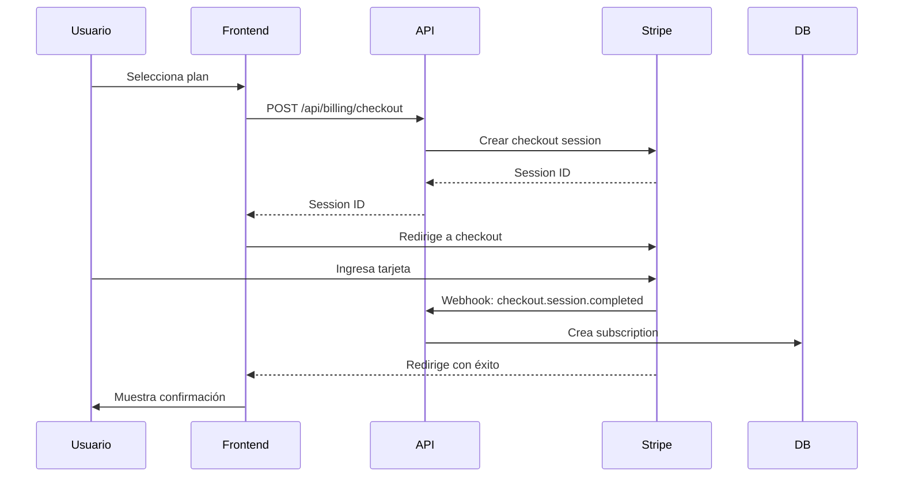

# 💳 Sistema de Billing con Stripe

Sistema completo de facturación y suscripciones integrado con Stripe para la plataforma de aprendizaje online.

## 🚀 Características

### Para Empresas

- 📊 **Dashboard de billing** con información completa
- 💎 **3 planes de suscripción** (Free, Premium, Enterprise)
- 💳 **Checkout seguro** powered by Stripe
- 🔄 **Portal de autogestión** para cambiar planes y métodos de pago
- 📄 **Historial de facturas** con descarga de PDFs
- 📈 **Métricas de uso** en tiempo real
- ⚡ **Límites dinámicos** según el plan
- 🔔 **Alertas** de pagos atrasados y cancelaciones

### Para Desarrolladores

- 🛠️ **API REST completa** para billing
- 🔐 **Webhooks seguros** con verificación de firmas
- 📦 **Sincronización automática** con Stripe
- 🗄️ **Base de datos** estructurada para subscriptions e invoices
- 🧪 **Testing fácil** con Stripe test mode
- 📚 **Documentación completa**

## 📦 Componentes

### Backend (`/app/api/billing/`)

- `checkout/` - Crear sesiones de pago
- `portal/` - Portal de gestión de suscripciones
- `webhooks/` - Recibir eventos de Stripe
- `subscription/` - Obtener suscripción actual
- `invoices/` - Historial de facturas
- `plans/` - Planes disponibles

### Frontend

- `app/workspace/company/billing/page.tsx` - UI de billing
- `hooks/use-billing.ts` - Hook para gestión de billing

### Servicios

- `lib/stripe.ts` - Configuración y helpers de Stripe

### Base de Datos

- `subscriptions` - Suscripciones de empresas
- `invoices` - Historial de facturas

## 💰 Planes Disponibles

| Plan           | Precio/mes | Precio/año | Empleados | Características                                         |
| -------------- | ---------- | ---------- | --------- | ------------------------------------------------------- |
| **Free**       | $0         | -          | 5         | Cursos básicos, Certificados básicos, Soporte email     |
| **Premium**    | $299       | $2,990     | 50        | Todo ilimitado, Soporte prioritario, Dashboard completo |
| **Enterprise** | $999       | $9,990     | ∞         | Todo Premium + API, Custom branding, Soporte 24/7       |

## 🎬 Quick Start

### 1. Configurar Stripe

```bash
# Crear cuenta en stripe.com
# Obtener API keys del dashboard
# Crear productos y precios
```

### 2. Variables de Entorno

```env
STRIPE_SECRET_KEY=sk_test_...
NEXT_PUBLIC_STRIPE_PUBLISHABLE_KEY=pk_test_...
STRIPE_WEBHOOK_SECRET=whsec_...
STRIPE_PREMIUM_PRICE_ID=price_...
STRIPE_PREMIUM_YEARLY_PRICE_ID=price_...
STRIPE_ENTERPRISE_PRICE_ID=price_...
STRIPE_ENTERPRISE_YEARLY_PRICE_ID=price_...
```

### 3. Migrar Base de Datos

```bash
npm run db:generate
npm run db:push
```

### 4. Testing Local

```bash
# Terminal 1: Stripe CLI
stripe listen --forward-to localhost:3000/api/billing/webhooks

# Terminal 2: Servidor
npm run dev
```

### 5. Probar

1. Ir a `http://localhost:3000/workspace/company/billing`
2. Seleccionar un plan
3. Usar tarjeta: `4242 4242 4242 4242`
4. Completar el pago
5. Verificar la suscripción

## 📖 Documentación

- **[BILLING_QUICKSTART.md](./BILLING_QUICKSTART.md)** - Configuración rápida (10 min)
- **[BILLING_SETUP.md](./BILLING_SETUP.md)** - Guía completa de configuración
- **[STRIPE_ENV_VARIABLES.md](./STRIPE_ENV_VARIABLES.md)** - Variables de entorno
- **[BILLING_IMPLEMENTATION_SUMMARY.md](./BILLING_IMPLEMENTATION_SUMMARY.md)** - Detalles técnicos

## 🔐 Seguridad

- ✅ Webhooks con verificación de firma
- ✅ Autenticación en todas las rutas
- ✅ No se almacenan datos de tarjetas
- ✅ PCI compliance a través de Stripe
- ✅ HTTPS requerido en producción

## 🧪 Testing

### Tarjetas de Prueba

```
✅ Pago exitoso:    4242 4242 4242 4242
❌ Pago rechazado:  4000 0000 0000 0002
🔐 Require 3DS:     4000 0027 6000 3184
```

### Flujos de Prueba

1. ✅ Crear suscripción
2. ✅ Ver historial de facturas
3. ✅ Cambiar plan
4. ✅ Actualizar método de pago
5. ✅ Cancelar suscripción
6. ✅ Reactivar suscripción

## 📊 Base de Datos

### Tabla: subscriptions

```typescript
{
  id: UUID;
  company_id: UUID;
  stripe_customer_id: string;
  stripe_subscription_id: string;
  status: "active" | "canceled" | "past_due" | "trialing";
  plan_name: "free" | "premium" | "enterprise";
  current_period_start: Date;
  current_period_end: Date;
  cancel_at_period_end: boolean;
}
```

### Tabla: invoices

```typescript
{
  id: UUID;
  company_id: UUID;
  stripe_invoice_id: string;
  amount: number;
  currency: string;
  status: "paid" | "open" | "void";
  pdf_url: string;
  paid_at: Date;
}
```

## 🔄 Flujo de Suscripción



## 🌐 API Routes

### POST /api/billing/checkout

Crea una sesión de checkout de Stripe

**Request:**

```json
{
  "priceId": "price_...",
  "companyId": "uuid"
}
```

**Response:**

```json
{
  "sessionId": "cs_...",
  "url": "https://checkout.stripe.com/..."
}
```

### POST /api/billing/portal

Crea una sesión del portal de clientes

**Request:**

```json
{
  "companyId": "uuid"
}
```

**Response:**

```json
{
  "url": "https://billing.stripe.com/..."
}
```

### GET /api/billing/subscription?companyId=uuid

Obtiene la suscripción actual

**Response:**

```json
{
  "id": "uuid",
  "plan": {
    /* plan object */
  },
  "status": "active",
  "currentPeriodEnd": "2024-02-15T00:00:00Z",
  "cancelAtPeriodEnd": false
}
```

### GET /api/billing/invoices?companyId=uuid

Obtiene el historial de facturas

**Response:**

```json
{
  "invoices": [
    /* array of invoices */
  ],
  "stats": {
    "total": 12,
    "paid": 11,
    "pending": 1,
    "totalPaid": 358800
  }
}
```

## 🔧 Hook: useBilling

```typescript
const {
  // Estado
  loading,
  subscription,
  invoices,
  invoiceStats,
  plans,

  // Métodos
  createCheckoutSession,
  openCustomerPortal,
  downloadInvoice,
  viewInvoice,
  hasFeature,
  checkUsageLimit,

  // Helpers
  isFreePlan,
  isActive,
  isCanceled,
  isPastDue,
} = useBilling(companyId);
```

## 🎨 UI Components

La página de billing incluye:

- 📊 **Dashboard principal** con plan actual
- 💳 **Selector de planes** con toggle mensual/anual
- 📈 **Métricas** (total gastado, facturas, próximo pago)
- 📄 **Historial de facturas** con descarga de PDFs
- ⚙️ **Gestión de suscripción** con botones de acción
- ⚠️ **Alertas** de estado (pagos atrasados, cancelaciones)
- 📊 **Límites de uso** con barras de progreso

## 🚀 Deployment

### Requisitos

- Activar cuenta de Stripe
- Obtener claves live (`sk_live_`, `pk_live_`)
- Configurar webhooks de producción
- Actualizar variables de entorno

### Checklist

- [ ] Activar cuenta de Stripe
- [ ] Crear productos en modo live
- [ ] Obtener claves live
- [ ] Configurar webhook endpoint
- [ ] Actualizar variables de entorno
- [ ] Hacer deploy
- [ ] Probar en producción
- [ ] Configurar alertas

## 📈 Métricas

Monitorea en Stripe Dashboard:

- **MRR** - Monthly Recurring Revenue
- **Churn Rate** - Tasa de cancelación
- **Active Subscriptions** - Suscripciones activas
- **Failed Payments** - Pagos fallidos
- **Conversion Rate** - Tasa de conversión

## 🐛 Troubleshooting

### Webhooks no se reciben

1. Verifica que Stripe CLI esté corriendo
2. Verifica la URL del webhook
3. Revisa el webhook secret

### Error al crear checkout

1. Verifica las API keys
2. Verifica los Price IDs
3. Revisa los logs del servidor

### Suscripción no se guarda

1. Verifica que las tablas existen
2. Revisa los webhooks en Stripe
3. Verifica los logs del servidor

Ver **[BILLING_SETUP.md](./BILLING_SETUP.md)** para más detalles.

## 📝 Licencia

Este código es parte de la plataforma de aprendizaje online.

## 🤝 Soporte

- **Stripe Docs:** https://stripe.com/docs
- **Stripe Support:** https://support.stripe.com
- **Testing:** https://stripe.com/docs/testing

---

**Implementado con ❤️ usando Next.js 15, Stripe, y PostgreSQL**
